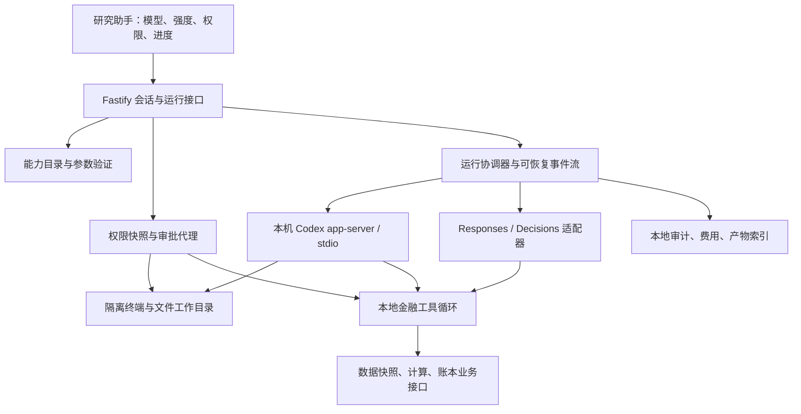

# 完整研究代理：模型能力与权限边界

研究日期：2026-11-02。结论类型：官方资料核对与实现设计；没有调用付费推理API，没有验证某个账户的模型资格。官方页面与本机 Codex CLI 0.166.0 均可能演进，落地时须重新读取运行时能力。

## 结论

Finance 的完整研究模式应接入本机 **Codex app-server**，用其线程、工具事件、审批和中断协议承载终端与文件任务；现有 Responses/Decisions 继续承担结构化金融研究与决策。Fastify 统一管理授权、工具执行、数据快照和审计。不能承诺“任意OpenAI模型具备全部Codex能力”：模型、API端点、客户端执行环境与账户资格是不同条件。

这是一项工程选择，而不是官方要求。选择 app-server 的依据是官方将它定位为嵌入产品的长期会话和交互代理接口；`codex exec` 适合非交互批任务，SDK封装常见程序调用，app-server提供更细的生命周期和审批控制。[官方集成层说明](https://developers.openai.com/blog/codex-as-a-platform)

## 已核实的能力边界

| 能力 | 官方事实 | Finance落点 |
|---|---|---|
| 模型目录 | `/v1/models` 返回ID、创建信息、归属和停用日期等；没有完整工具与reasoning能力矩阵。 | 返回“可见/能力已核实/实测成功”三种独立状态，不以目录出现作为全部能力可用证明。[Models接口](https://developers.openai.com/api/reference/resources/models/methods/list) |
| 推理强度 | 参数依模型变化。Sol 6.1 支持 low/medium/high/xhigh/max，默认medium；Luna 6另支持none。Sol 6.1工具调用使用Responses。 | API适配器校验模型×端点×effort。Codex适配器使用自身目录返回值，不能把CLI的ultra直接发送为普通Responses effort。[Sol模型页](https://developers.openai.com/api/docs/models/gpt-6.1-sol)、[Luna模型页](https://developers.openai.com/api/docs/models/gpt-6-luna) |
| 推理内容 | 官方提供推理摘要配置，不暴露原始内部推理token。 | 展示支持的摘要、工具过程、来源和结论，不承诺显示内部完整思维过程。[Reasoning](https://developers.openai.com/api/docs/guides/reasoning) |
| 工具循环 | 自定义函数由应用执行，结果以匹配call_id的function_call_output送回；一个回复可包含多个工具请求。 | 通用run循环需要执行→回传→继续，不能在取得第一批工具结果后就宣称代理已完成。[Function calling](https://developers.openai.com/api/docs/guides/function-calling) |
| 终端 | Responses shell支持托管容器或local环境；local模式返回shell_call，由本地应用执行并回传stdout、stderr和outcome。 | 本机CPU工作由隔离runner承担；托管shell不能冒充本机执行。[Shell](https://developers.openai.com/api/docs/guides/tools-shell) |
| 文件搜索 | 托管file_search基于上传文件和vector store。 | 个人本地文件检索另建工具；是否上传文件是独立许可，不应与“允许读本地文件”合并。[File search](https://developers.openai.com/api/docs/guides/tools-file-search) |
| 网页搜索 | 新集成使用web_search，可返回引用；external_web_access控制live/cache。auto允许模型不搜索，要求检索的任务应显式要求工具执行。 | 保存实际检索的URL/访问时间/摘录及引用，不能将模型生成的网址认作已经访问。[Web search](https://developers.openai.com/api/docs/guides/tools-web-search) |
| MCP | Responses可连接远程MCP，支持allowed_tools和逐工具approval响应。 | 本机MCP由本机runner/网关连接；远端MCP需要可达地址或单独隧道方案。授权绑定server+tool+参数，不自动给全部连接器写权限。[MCP](https://developers.openai.com/api/docs/guides/tools-connectors-mcp) |
| 动态工具 | tool_search对支持模型可延迟加载工具，函数/MCP可标defer_loading。 | 工具发现结果仍要过应用权限；搜索到工具不代表可以执行。[Tool search](https://developers.openai.com/api/docs/guides/tools-tool-search) |
| 多代理 | Responses已有原生Multi-agent Beta，页面列明Sol 6.1及GPT-5.6系列；有专属限制，如不支持reasoning.summary和max_tool_calls。 | 先按能力开关启用；不支持模型用应用编排独立run。多代理不等于多份独立金融证据。[Responses Multi-agent](https://developers.openai.com/api/docs/guides/responses-multi-agent) |
| Codex子代理 | 子代理继承父会话沙箱/审批/MCP；角色说明文字不能创建单独只读沙箱。 | 若研究员与执行员须有不同硬权限，启动独立runner/会话，而不是仅写“你不能修改”。[Codex子代理](https://learn.chatgpt.com/docs/agent-configuration/subagents) |
| Decisions | choice/score返回分布与confidence，官方建议用应用标注样本设定阈值。 | Decisions保留专用适配器，账户行动分布不能直接改称盈利概率，也不能把聊天的reasoning参数跨端点照搬。[Decisions](https://developers.openai.com/api/docs/guides/decisions) |

## Codex协议与本机核验

已实际运行 `codex --version`、`codex app-server --help`、`codex exec --help`、`codex app-server generate-json-schema --out <临时目录> --experimental`，无推理请求。由生成schema确认：

- `model/list`含supportedReasoningEfforts、defaultReasoningEffort、inputModalities、serviceTiers、multiAgentVersion；字段存在不代表某个实例一定有值。
- 本版本`modelProvider/capabilities/read`仅有webSearch和imageGeneration，不能拿它推断所有工具。
- `thread/start`有permissions或sandbox、dynamicTools、ephemeral和runtimeWorkspaceRoots；命名权限profile与旧sandbox互斥。
- `turn/start`支持model和effort覆盖；multiAgentMode已弃用，schema提示ultra有特定代理行为。是否可选仍须听从model/list结果。
- 命令审批decline继续会话、cancel同时中断turn；文件与权限请求有各自响应schema。

官方协议要求先initialize/initialized，随后thread/start、turn/start，接收item事件。支持model/list、turn/interrupt与command/file/permission审批；dynamicTools需要experimentalApi。`process/spawn`属于沙箱外显式进程接口，**不得用于替代沙箱内命令执行**。[App-server协议](https://learn.chatgpt.com/docs/app-server)

本次未启动真实研究会话、未验证上游模型资格、未读取用户Codex认证文件。实验字段须绑定CLI版本并由契约测试覆盖；界面不得假定“升级CLI后旧字段含义不变”。

## Fastify落地设计（工程建议）

建议新增agent-runner、capability-registry、permission-broker、tool-registry和run-events模块，保留既有账本与数学模块。完整模式使用独立进程和stdio，浏览器不能直接调用任意JSON-RPC方法。模型目录支持分页、过期时间、来源版本、可用性证据；新模型默认能力unknown，已核实后开放对应控件。

每次run固定`engine/model/effort/capabilityRevision/permissionRevision/snapshotId`。切模型不静默变更权限；不兼容effort在启动前返回结构化错误并给出受支持选项。普通Responses与Codex模式的上下文存储策略分别标示；金融账本持久化和聊天记忆是两件事。

建议接口：

| 接口 | 契约 |
|---|---|
| GET /api/agent/capabilities | 返回能力证据、CLI版本、模型努力级别、可用工具、限制；不返回密钥 |
| POST /api/agent/runs | 幂等clientRequestId；验证能力与权限后202+runId，不等待完整推理 |
| GET /api/agent/runs/:id/events | SSE带递增序号，支持Last-Event-ID；含工具/引用/产物/审批状态 |
| POST /api/agent/runs/:id/approvals/:approvalId | 仅当前会话持有人；审批请求哈希与过期时间匹配；接受已批准范围内动作可由持久授权自动判定 |
| POST /api/agent/runs/:id/cancel | 幂等；立即停止派发新工具；已执行动作保留回执 |
| GET /api/agent/runs/:id/artifacts | 本地相对产物ID与受控下载；不接受任意文件绝对路径 |

## 独立权限必须真实隔离

用户要求完整终端/文件能力，并不意味着所有运行均共享无限权限。面板提供独立开关及作用域：portfolio.read、ledger.write、files.read、files.write、shell.execute、shell.network、web.search、file.upload、MCP逐server/tool、subagent.spawn。已授权范围内不重复询问；新增路径、联网目标或工具范围才触发具体审批。

官方明确命令沙箱的网络策略不是全局策略：web search、MCP、浏览器、连接器与模型服务流量各有控制。启用网络域名规则还需要网络proxy；只填域名列表并不自动执行过滤。macOS使用Seatbelt，不可强制执行的策略应拒绝而非静默降级。[权限文档](https://learn.chatgpt.com/docs/permissions)

据此建议：

1. shell.execute不能绕过files.write=false：必须由操作系统沙箱拒绝写入，不能只靠命令字符串黑名单。禁网也由runner网络策略与MCP/web独立开关共同落实。
2. 金融工作目录用于资料、脚本、图表；生产SQLite、环境密钥和钥匙串不直接暴露给终端。账本写入仍走现有业务校验、幂等键、冲销机制。
3. 子进程用最小环境变量和单独配置目录；不继承浏览器会话令牌、CSRF和无关凭据。更强隔离可由Fastify推理网关持有OpenAI Key，给runner限run凭据；该网关只代理被允许的端点、模型和请求类别。
4. 审批绑定命令/路径/host/MCP调用的实际参数摘要；跨run审批拒绝。权限撤回后尚未执行的请求重新判定，不能沿用旧授权。
5. 完整terminal不等于启用`danger-full-access`或沙箱外process/spawn；如果用户主动选择更宽路径范围，明确显示新增作用域并记录。

## 拒绝、取消和审计契约（工程建议）

运行状态：queued → running → waiting_approval → running → completed / failed / cancelled；遇到传输后果不明另记outcome_unknown，而不是假装失败后自动重发。

- **模型拒绝**：返回refused及可显示原因，不执行下游工具，不把拒绝变成空分析成功。
- **权限拒绝**：记录denied，向模型返回结构化工具错误；不得改用shell或另一MCP绕过同一限制。
- **取消**：Codex发turn/interrupt后等最终interrupted事件；本地进程终止及子进程回收单独核验。Responses background可调用cancel端点且取消接口幂等；前端断开SSE不是取消成功。[后台取消](https://developers.openai.com/api/docs/guides/background)
- **取消竞态**：已经完成的文件修改或账本记录不能标为“从未发生”；展示已完成/取消前未完成/结果不明三类回执。未知付费请求保留费用待结算，不自动重复发送。
- **事件审计**：runId、parentRunId、thread/turn/item/callId、snapshotId、模型、强度、工具名、参数哈希、权限版本、审批主体、来源时间、开始/结束、退出码、内容摘要/哈希、费用与产物ID。审计使用脱敏参数，原始敏感附件不写公共日志。
- **任务约束**：本机计算设置超时、输出大小、并发数与CPU工作队列；各run取消传递到子代理。独立读任务可并发，账本/同一文件冲突写入按资源串行。

## 当前代码差距与实施顺序

本地源码观察：`src/server/ai.ts`的模型supported字段取决于MODEL_PRICING，价格已知与工具能力混在一起；chat仅支持单个record_transaction调用和一次执行回执。`src/web/App.tsx`助手页面显示模型/强度，但选择在偏好页。此处是本地代码事实，未据此推断任何线上服务状态。

1. 先交付会话级模型/强度选择、完整能力目录、结构化拒绝和流式run事件；把价格验证与模型能力分开。
2. 接入本机计算/来源检索等只读工具循环；使用已有账本回执作为唯一写成功证据。
3. 接入app-server完整研究模式，终端、文件、联网、MCP各自授权，集成版本化协议与取消。
4. 以实测能力开放多代理、技能与附件；只读研究员和有写权限执行员采用独立权限runner。

验收必须含：不支持模型/effort组合；工具结果继续推理；文件只读时shell尝试写入被拒；跨目录与符号链接边界；web关但shell联网开的独立行为；MCP拒绝后不执行；审批重放/跨run拒绝；取消长命令及其子进程；中断后已记账回执保留；多代理并发写冲突；秘密不进日志；模型目录可见但实际权限不足；重连SSE不重复工具副作用。未通过这些测试前不得宣传“完整Codex功能已经实现”。
