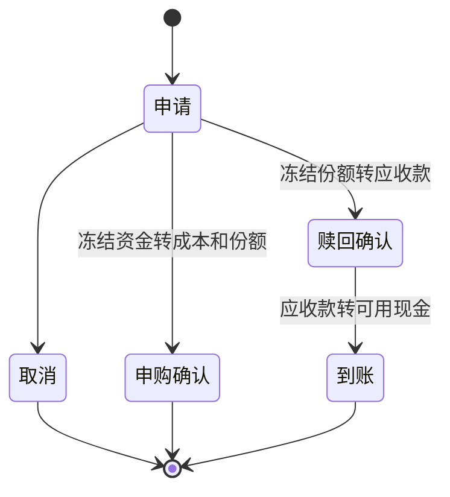

# 资金口径与预算

## 账本

金额用 Decimal，资金输入精确到分，份额可有八位小数。每个账户、币种分别持有可用现金、冻结资金和应收款。人民币总览必须有有效价格与外币汇率，否则显示“不可计算”，不把未知项写成零。

`deposit` / `withdraw` 是外部资金流；`opening` 用于导入已有份额与期初成本。`buy` / `sell` 表示已成交，不能用来登记未来计划。定投计划独立保存，不自动创建成交记录。

基金状态流程：



每次写入携带幂等键。重复提交同一事件返回原回执；同键不同内容拒绝。撤销创建冲销记录，不删除原流水；若撤销后会使后续交易资金不足或引用失效，则拒绝，需先处理依赖项。

总盈亏口径：`当前净资产 - 累计外部净流入`。交易费用单列，不重复计入持仓成本。成本采用移动加权分摊，保留取得日期批次计算结算等待；最后一笔卖出清除成本尾差。

纯人民币账本核对：`总盈亏 = 已实现 + 未实现 + 分红利息 - 费用税费`。外币资金流必须录入发生日人民币汇率，才能核对跨币种总收益。当前版本跨币种分项以当前参考汇率折算，**完整历史汇率归因未实现**，界面有提示；不会把分项差额冒充完整价格/汇率归因。

TWR 与回撤只覆盖有完整估值且资金流边界可确定的快照区间。有期间外部资金流但缺少流入时点估值时，精确 TWR 留空，仅提供明确标为估算的日末资金流曲线。XIRR 使用实际记账日期，365 日年化；多解或缺少有效正负现金流时不可计算。波动率需至少20个完整日度收益间隔，不从两点走势编造风险指标。

## 金额建议

产品交易渠道名称必须匹配一个真实账本账户。不能从另一银行账户借用现金，也不能把两个账户零碎股数凑成一手。参数包括用户核实的最高适用费率、最小金额、交易单位、渠道上限；复杂分档赎回费暂按用户填写的最高适用费率保守估算，实际确认金额仍由用户记账。

买入候选来自合法上限的25%、50%、100%，包括手续费预算、最低现金与买入后仓位约束；卖出候选来自该账户合法可卖上限，百分比按整个产品总持仓计算。取整后重复或非法档位删除，可能少于三档。多条有效买入告警共享以人民币计量的总现金预留。

金额候选支持 CNY、USD、HKD、GBP、EUR。产品金额、数量对应价格、渠道限额、费用、预计净额均保留原币；最低现金、单笔限额和组合仓位统一按人民币检验。设 `r` 为 1 原币对应的人民币参考汇率，当前买入可用金额的人民币上限为：

```text
max(0, min(指定账户该币可用现金 × r,
           组合全部可用现金折人民币 − 最低现金保留)
       − 其他有效买入告警的人民币预留)
```

这个上限再按汇率换算成原币，与单笔人民币限额折算值、买入后仓位空间及原币渠道限额共同限制候选。即使同一账户还有人民币，美元候选也只能使用该账户已有美元现金；不会借用其他账户、自动换汇或把应收/冻结资金当现金。卖出量受指定账户已结算可卖份额、交易单位以及“单笔人民币限额 ÷ 汇率”共同限制。

手续费先在原币向上取到分，再折算成人民币用于风险检查。共享现金预留使用 `candidateCashRequiredCny()` 的精确人民币十进制结果，不把美元金额直接当人民币，也不将不足一人民币分的预留向下丢弃。界面保留原币费用和净额，并显示带日期的人民币参考折算；这些参考值不是实际换汇成交价。

快照保留 `fxRates` 与 `fxAsOf`。外币汇率缺失、非正数、无效日期、来自未来或超过 4 个自然日时，确定性金额候选直接停止；人民币恒等汇率为 1。组合可用现金含有无法换算的其他币种时，同样不能据此满足人民币现金底线。旧快照缺少汇率证据时不会推测外币建议。USD 买卖、HKD 交易单位、账户隔离、汇率转换、费用与现金/仓位上限均有合成用例验证，实际买卖仍由用户执行。

## API 预算

每个请求先在 SQLite 事务中原子预留，发出后按返回 usage 结算。文本输入按 UTF-8 字节上界、协议余量、最大输出及缓存写入费用保守预留。reasoning 是输出 token 的子集，不重复计费。Decisions 按两个问题保守预留公共输入，实际以 usage 结算。

| 用途           | 自然月上限 |
| -------------- | ---------: |
| Decisions      |        $45 |
| 简报           |        $15 |
| 对话           |        $10 |
| 复核           |         $5 |
| 金额评价       |         $5 |
| 验证           |         $5 |
| 未主动使用余量 |         $5 |

用户月上限不得超过 $90，正常请求使用上限为“月上限减 $5”，还受用户确认的实际 Credit 有效期与可分配金额限制。北京时间自然月和赠额账期同时约束。超时/非成功响应无法确认费用时，预留保留，不自动重试、不跨月自动释放。实际费用异常超过预留会关闭后续调用，需核对。

价格表在 `budget.ts`，带核验来源和到期日。未知价格或超过已核实上下文长度时直接拒绝，不估一个便宜价格继续请求。本地控制不覆盖组织内其它应用的花费；专用项目应同时配置官方支出限额，并确认自动充值设置。

打开页面会刷新免费数据并尝试生成当次简报，费用条件不满足时展示原因。关闭 API 不影响免费数据和手动记账。代码默认不调用付费 Web Search 或图片生成，资料预览为本地生成的文字卡。
