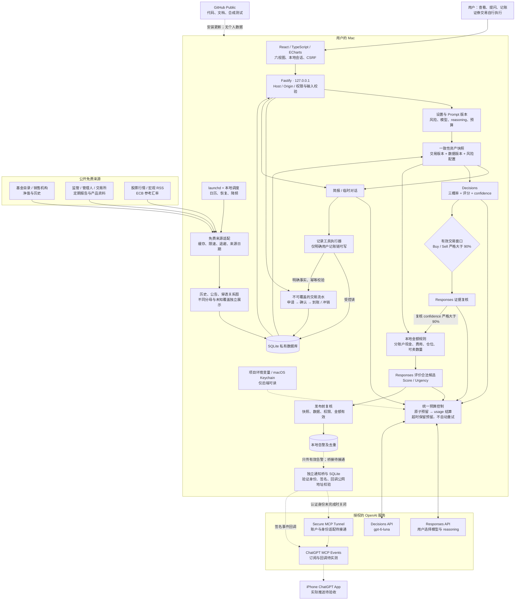

# 系统架构

浏览器和 Fastify 在本机同源运行；只监听 `127.0.0.1`。所有第三方连接都由后端发起。持仓、费用预留、Prompt 版本和分析审计保存 SQLite；对话正文只存在当前页面与进行中的会话，不建立长期用户记忆。

实线表示本地代码已有实现的路径；通知虚线表示独立组件已经具备测试，但官方连接、可信身份适配及手机送达尚未完成。主程序不会把待完成通知显示成已经送达。

## 模块契约

| 模块                                        | 责任                                           | 不具备的权限                      |
| ------------------------------------------- | ---------------------------------------------- | --------------------------------- |
| `ledger.ts`                                 | 十进制流水、在途状态、幂等、冲销、移动均价成本 | 下单、访问 API Key                |
| `portfolio.ts` / `returns.ts`               | 汇总、快照版本、收益口径与缺失状态             | 伪造估值、覆盖历史流水            |
| `providers.ts` / `feeds.ts` / `exposure.ts` | 限制来源的公开数据读取、解析、穿透             | 执行网页 JS、执行报告内指令       |
| `ai.ts` / `budget.ts`                       | 固定边界、可编辑模板、模型校验、费用预留       | 绕过交易校验、后台写账本          |
| `risk.ts`                                   | 交易日历、分账户约束、确定性金额候选           | 决定实际成交、借用其它账户现金    |
| `notifications.ts`                          | 独立 outbox、认证订阅、回调验证与重试          | 读取主账本、访问 Platform API Key |

新闻和报告均是低信任证据；模型工具只接受服务器定义的结构。授权头不进入模型输入、导出、浏览器或日志。
